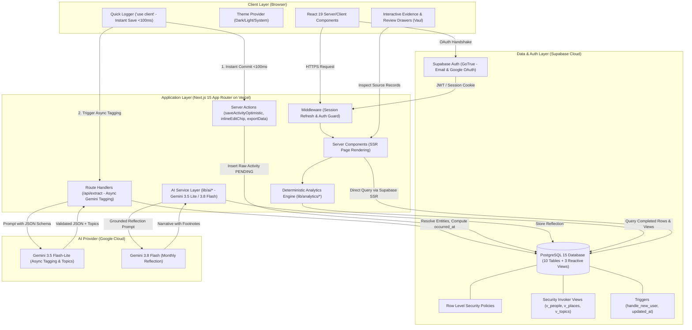
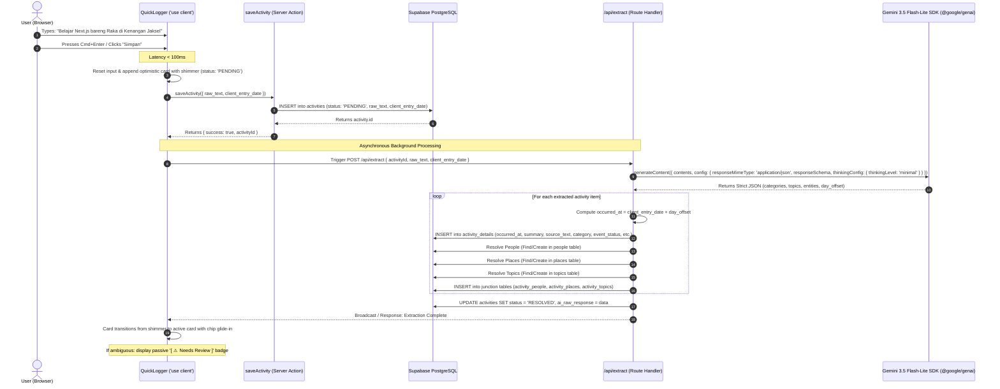

# Life Memory — System Architecture Blueprint

> **Document Version:** 1.3  
> **Status:** Approved for Implementation (Sprint 0 Deliverable)  
> **Target Stack:** Next.js 16 (App Router with `proxy.ts`), React 19, TypeScript 5, Supabase (PostgreSQL 15, Auth, RLS), Google Gemini 3.5 Flash-Lite / 3.8 Flash (`@google/genai`), Tailwind CSS, Motion, Vaul, Vercel  
> **Development Start:** Fleksibel / Dapat dimulai kapan saja (Anytime).

---

## 1. Architectural Philosophy & Principles

Life Memory transforms ephemeral daily logs into structured, introspective life intelligence. The architecture is guided by five foundational principles:

1. **Deterministic Core, AI at the Periphery:** AI never calculates what PostgreSQL and TypeScript can compute deterministically. Gemini extracts structured entities and topics from text and crafts reflective narratives from computed facts; all counts, pattern frequencies, temporal comparisons, and recurrence metrics are strictly deterministic.
2. **Instant Save-First Architecture (<100ms):** Logging an activity must be frictionless. The raw text is committed to the database in <100ms with status `PENDING`, rendering an optimistic card with shimmer. LLM tagging runs asynchronously in the background. No blocking preview modal interrupts the user.
3. **Atomic Granularity & Explicit Event Date:** `activity_details` is the atomic unit of truth. Each item stores its own resolved `occurred_at` date calculated at extraction time (`client_entry_date + day_offset`). Multi-activity logs cleanly produce discrete items with individual dates and categories.
4. **Reactive Views Over Cached Counters:** Interaction counts, visit counts, topic counts, and boundary dates (`first_seen_at`, `last_seen_at`) are dynamically computed via PostgreSQL Views with `event_status = 'completed'` filtering. This eliminates cache desynchronization during backdates, edits, and deletions.
5. **Database-Enforced Multi-Tenant Privacy:** All user data is partitioned at the PostgreSQL storage layer via Row Level Security (`auth.uid() = user_id`). Security-invoker views strictly inherit base table RLS.

---

## 2. High-Level System Architecture Diagram



---

## 3. Next.js App Router Directory Structure

```
d:/PORTFOLIO/life-memory/
├── app/
│   ├── (auth)/
│   │   ├── login/
│   │   │   └── page.tsx              # Email/Password + Google OAuth Login + ToS Notice
│   │   ├── register/
│   │   │   └── page.tsx              # User Registration + Privacy Disclosure
│   │   └── auth/
│   │       └── callback/
│   │           └── route.ts          # Supabase OAuth PKCE exchange handler
│   ├── (dashboard)/
│   │   ├── layout.tsx                # Protected App Shell (Sidebar, Header with ⌘K, Nav)
│   │   ├── dashboard/
│   │   │   └── page.tsx              # Main Dashboard (KPI cards, recent logs, teaser)
│   │   ├── timeline/
│   │   │   └── page.tsx              # Chronological activity stream with filters & S-14 reveal
│   │   ├── people/
│   │   │   ├── page.tsx              # Social connections directory (v_people_with_stats)
│   │   │   └── [id]/
│   │   │       └── page.tsx          # Person detail & shared activity history
│   │   ├── places/
│   │   │   ├── page.tsx              # Places visited directory (v_places_with_stats)
│   │   │   └── [id]/
│   │   │       └── page.tsx          # Place detail & visit history
│   │   ├── topics/
│   │   │   ├── page.tsx              # Topics & skills directory (v_topics_with_stats)
│   │   │   └── [id]/
│   │   │       └── page.tsx          # Topic detail & occurrence history
│   │   ├── insights/
│   │   │   └── page.tsx              # Discovered patterns & evidence-backed feed
│   │   ├── reflection/
│   │   │   └── page.tsx              # AI Monthly Reflection reader & generator
│   │   ├── forgot-this/
│   │   │   └── page.tsx              # "You Probably Forgot This" card reveal (S-14)
│   │   └── settings/
│   │       └── page.tsx              # Theme toggle, full JSON export & account management
│   ├── api/
│   │   └── extract/
│   │       └── route.ts              # Gemini 3.5 Flash-Lite extraction API handler (@google/genai)
│   ├── layout.tsx                    # Root HTML layout, ThemeProvider, Fonts
│   ├── page.tsx                      # Public Landing Page (Hero, Features, "✦ Try Demo", CTA)
│   ├── globals.css                   # Tailwind CSS base styles & custom utilities
│   └── not-found.tsx                 # Custom 404 page
├── components/
│   ├── ui/                           # Primitive UI components (Button, Card, Badge, Chip, Skeleton)
│   ├── layout/                       # Sidebar, Header with ⌘K, MobileNav, ThemeToggle
│   ├── activity/                     # QuickLogger, TimelineCard, EntityReviewDrawer
│   ├── people/                       # PersonCard, InteractionBadge
│   ├── places/                       # PlaceCard, VisitFrequencyChart
│   ├── topics/                       # TopicCard, TopicRecurrenceBadge
│   ├── insights/                     # InsightCard, EvidenceDrawer (Vaul)
│   └── reflection/                   # ReflectionView, MemoryRevealCard, FootnotePopover
├── lib/
│   ├── ai/
│   │   ├── gemini.ts                 # Google GenAI client instance & configuration (@google/genai)
│   │   ├── extract.ts                # Extraction prompt runner & schema validator (Gemini 3.5 Flash-Lite)
│   │   ├── reflection.ts             # Monthly reflection prompt builder & caller (Gemini 3.8 Flash)
│   │   └── forgot.ts                 # Deterministic memory reveal formatter (S-14)
│   ├── analytics/
│   │   ├── first-time.ts             # First-time experience detection logic
│   │   ├── recurrence.ts             # Recurring habit pattern engine (>=3 in calendar month)
│   │   ├── changes.ts                # Month-over-month trend & change engine (|Va-Vb| >= 3)
│   │   ├── stats.ts                  # Deterministic calendar month aggregation calculator
│   │   ├── scoring.ts                # Dormancy scoring heuristic for "You Probably Forgot This" (>=21d)
│   │   └── insights-generator.ts     # Master coordinator for insight creation & deduplication
│   ├── supabase/
│   │   ├── client.ts                 # Browser client (createBrowserClient)
│   │   ├── server.ts                 # Server client for RSC/Actions (createServerClient)
│   │   └── middleware.ts             # Session refresh helper for Next.js middleware
│   └── utils/
│       ├── normalization.ts          # Name, place & topic string normalizer
│       └── dates.ts                  # Date formatting, calculateOccurredAt & locale helpers
├── types/
│   ├── database.ts                   # Generated Supabase PostgreSQL types (including views)
│   ├── ai.ts                         # Gemini JSON Schema & extraction types (topics: string[])
│   └── domain.ts                     # Application models, filters, action payloads
├── middleware.ts                     # Edge auth route guard
└── tailwind.config.ts                # Design tokens, color palette, dark mode
```

---

## 4. Server vs. Client Component Demarcation

| Component Type | Boundary (`"use client"` vs Server) | Responsibility | Examples |
|---|---|---|---|
| **Page Containers** | **Server Component** | Fetches initial page data directly from Supabase with RLS; passes data down as props. | `app/(dashboard)/timeline/page.tsx`, `app/(dashboard)/people/page.tsx` |
| **Shell Layout** | **Server Component** | Validates session, renders static sidebar and header structure. | `app/(dashboard)/layout.tsx` |
| **Quick Logger** | **Client Component** | Manages textarea input, shortcut keys (`Cmd+Enter`), optimistic card insertion in <100ms. | `components/activity/QuickLogger.tsx` |
| **Interactive Drawers (Vaul)** | **Client Component** | Non-blocking bottom drawers for inspecting evidence citations and reviewing ambiguous entities. | `components/insights/EvidenceDrawer.tsx`, `components/activity/EntityReviewDrawer.tsx` |
| **Timeline Feed & Cards** | **Client Component** | Handles optimistic state progression, inline chip editing, and filter tabs. | `components/activity/TimelineCard.tsx` |
| **Theme & Toast Providers** | **Client Component** | Manages browser local storage for dark mode and transient toasts. | `ThemeProvider.tsx`, `ToastContainer.tsx` |

---

## 5. Complete Production Database Schema (Supabase PostgreSQL DDL)

This SQL script is ready to run directly in the Supabase SQL Editor during **Sprint 1**. It creates all 10 tables, 3 reactive stats views, constraints, trigger functions, RLS policies, and performance indexes.

```sql
-- ============================================================================
-- LIFE MEMORY — PRODUCTION DATABASE SCHEMA & RLS POLICIES (10 TABLES + 3 VIEWS)
-- ============================================================================

-- Enable UUID extension
CREATE EXTENSION IF NOT EXISTS "uuid-ossp";

-- ----------------------------------------------------------------------------
-- 1. TABLE: profiles
-- ----------------------------------------------------------------------------
CREATE TABLE public.profiles (
    id UUID PRIMARY KEY REFERENCES auth.users(id) ON DELETE CASCADE,
    email TEXT NOT NULL,
    full_name TEXT,
    avatar_url TEXT,
    created_at TIMESTAMPTZ NOT NULL DEFAULT TIMEZONE('utc', NOW()),
    updated_at TIMESTAMPTZ NOT NULL DEFAULT TIMEZONE('utc', NOW())
);

-- ----------------------------------------------------------------------------
-- 2. TABLE: activities (Raw user activity logs & pipeline status)
-- ----------------------------------------------------------------------------
CREATE TABLE public.activities (
    id UUID PRIMARY KEY DEFAULT uuid_generate_v4(),
    user_id UUID NOT NULL REFERENCES public.profiles(id) ON DELETE CASCADE,
    raw_text TEXT NOT NULL,
    client_entry_date DATE NOT NULL DEFAULT CURRENT_DATE, -- Anchor date passed to Gemini as reference_date
    status TEXT NOT NULL DEFAULT 'PENDING' CHECK (status IN ('PENDING', 'RESOLVED', 'FAILED')),
    ai_raw_response JSONB,
    created_at TIMESTAMPTZ NOT NULL DEFAULT TIMEZONE('utc', NOW()),
    updated_at TIMESTAMPTZ NOT NULL DEFAULT TIMEZONE('utc', NOW())
);

-- ----------------------------------------------------------------------------
-- 3. TABLE: activity_details (Atomic structured items extracted by AI)
-- ----------------------------------------------------------------------------
CREATE TABLE public.activity_details (
    id UUID PRIMARY KEY DEFAULT uuid_generate_v4(),
    activity_id UUID NOT NULL REFERENCES public.activities(id) ON DELETE CASCADE,
    user_id UUID NOT NULL REFERENCES public.profiles(id) ON DELETE CASCADE,
    summary TEXT NOT NULL,
    source_text TEXT NOT NULL,
    category TEXT NOT NULL CHECK (category IN (
        'career', 'social', 'health', 'learning', 'leisure', 'routine', 'other'
    )),
    occurred_at DATE NOT NULL, -- Computed server-side: client_entry_date + (day_offset || INTERVAL '1 day')
    day_offset INTEGER NOT NULL DEFAULT 0,
    time_of_day TEXT CHECK (time_of_day IN ('morning', 'afternoon', 'evening', 'night', 'exact', 'unknown')),
    time_hint TEXT,
    event_status TEXT NOT NULL DEFAULT 'completed' CHECK (event_status IN (
        'completed', 'planned', 'cancelled'
    )),
    is_first_time BOOLEAN NOT NULL DEFAULT FALSE,
    created_at TIMESTAMPTZ NOT NULL DEFAULT TIMEZONE('utc', NOW())
);

-- ----------------------------------------------------------------------------
-- 4. TABLE: people (Detected individual contacts / friends)
-- ----------------------------------------------------------------------------
CREATE TABLE public.people (
    id UUID PRIMARY KEY DEFAULT uuid_generate_v4(),
    user_id UUID NOT NULL REFERENCES public.profiles(id) ON DELETE CASCADE,
    name TEXT NOT NULL,
    normalized_name TEXT NOT NULL,
    aliases TEXT[] NOT NULL DEFAULT '{}',
    created_at TIMESTAMPTZ NOT NULL DEFAULT TIMEZONE('utc', NOW()),
    updated_at TIMESTAMPTZ NOT NULL DEFAULT TIMEZONE('utc', NOW()),
    CONSTRAINT uq_user_person UNIQUE (user_id, normalized_name)
);

-- ----------------------------------------------------------------------------
-- 5. TABLE: places (Detected locations / venues)
-- ----------------------------------------------------------------------------
CREATE TABLE public.places (
    id UUID PRIMARY KEY DEFAULT uuid_generate_v4(),
    user_id UUID NOT NULL REFERENCES public.profiles(id) ON DELETE CASCADE,
    name TEXT NOT NULL,
    normalized_name TEXT NOT NULL,
    aliases TEXT[] NOT NULL DEFAULT '{}',
    created_at TIMESTAMPTZ NOT NULL DEFAULT TIMEZONE('utc', NOW()),
    updated_at TIMESTAMPTZ NOT NULL DEFAULT TIMEZONE('utc', NOW()),
    CONSTRAINT uq_user_place UNIQUE (user_id, normalized_name)
);

-- ----------------------------------------------------------------------------
-- 6. TABLE: topics (Detected subjects, skills, technologies, projects)
-- ----------------------------------------------------------------------------
CREATE TABLE public.topics (
    id UUID PRIMARY KEY DEFAULT uuid_generate_v4(),
    user_id UUID NOT NULL REFERENCES public.profiles(id) ON DELETE CASCADE,
    name TEXT NOT NULL,
    normalized_name TEXT NOT NULL,
    created_at TIMESTAMPTZ NOT NULL DEFAULT TIMEZONE('utc', NOW()),
    updated_at TIMESTAMPTZ NOT NULL DEFAULT TIMEZONE('utc', NOW()),
    CONSTRAINT uq_user_topic UNIQUE (user_id, normalized_name)
);

-- ----------------------------------------------------------------------------
-- 7. TABLE: activity_people (Junction: activity_details <-> people)
-- ----------------------------------------------------------------------------
CREATE TABLE public.activity_people (
    id UUID PRIMARY KEY DEFAULT uuid_generate_v4(),
    activity_detail_id UUID NOT NULL REFERENCES public.activity_details(id) ON DELETE CASCADE,
    person_id UUID NOT NULL REFERENCES public.people(id) ON DELETE CASCADE,
    user_id UUID NOT NULL REFERENCES public.profiles(id) ON DELETE CASCADE,
    created_at TIMESTAMPTZ NOT NULL DEFAULT TIMEZONE('utc', NOW()),
    CONSTRAINT uq_activity_person UNIQUE (activity_detail_id, person_id)
);

-- ----------------------------------------------------------------------------
-- 8. TABLE: activity_places (Junction: activity_details <-> places)
-- ----------------------------------------------------------------------------
CREATE TABLE public.activity_places (
    id UUID PRIMARY KEY DEFAULT uuid_generate_v4(),
    activity_detail_id UUID NOT NULL REFERENCES public.activity_details(id) ON DELETE CASCADE,
    place_id UUID NOT NULL REFERENCES public.places(id) ON DELETE CASCADE,
    user_id UUID NOT NULL REFERENCES public.profiles(id) ON DELETE CASCADE,
    created_at TIMESTAMPTZ NOT NULL DEFAULT TIMEZONE('utc', NOW()),
    CONSTRAINT uq_activity_place UNIQUE (activity_detail_id, place_id)
);

-- ----------------------------------------------------------------------------
-- 9. TABLE: activity_topics (Junction: activity_details <-> topics)
-- ----------------------------------------------------------------------------
CREATE TABLE public.activity_topics (
    id UUID PRIMARY KEY DEFAULT uuid_generate_v4(),
    activity_detail_id UUID NOT NULL REFERENCES public.activity_details(id) ON DELETE CASCADE,
    topic_id UUID NOT NULL REFERENCES public.topics(id) ON DELETE CASCADE,
    user_id UUID NOT NULL REFERENCES public.profiles(id) ON DELETE CASCADE,
    created_at TIMESTAMPTZ NOT NULL DEFAULT TIMEZONE('utc', NOW()),
    CONSTRAINT uq_activity_topic UNIQUE (activity_detail_id, topic_id)
);

-- ----------------------------------------------------------------------------
-- 10. TABLE: insights (Generated patterns, reflections, and notifications)
-- ----------------------------------------------------------------------------
CREATE TABLE public.insights (
    id UUID PRIMARY KEY DEFAULT uuid_generate_v4(),
    user_id UUID NOT NULL REFERENCES public.profiles(id) ON DELETE CASCADE,
    type TEXT NOT NULL CHECK (type IN (
        'first_time', 'recurring', 'change', 'forgotten', 'reflection'
    )),
    title TEXT NOT NULL,
    description TEXT NOT NULL,
    category TEXT,
    evidence JSONB NOT NULL DEFAULT '[]'::jsonb,
    is_read BOOLEAN NOT NULL DEFAULT FALSE,
    is_suppressed BOOLEAN NOT NULL DEFAULT FALSE,
    metadata JSONB DEFAULT '{}'::jsonb,
    created_at TIMESTAMPTZ NOT NULL DEFAULT TIMEZONE('utc', NOW())
);

-- ============================================================================
-- REACTIVE VIEWS (SECURITY INVOKER)
-- ============================================================================

-- 1. View: People with derived counts & boundaries
CREATE OR REPLACE VIEW public.v_people_with_stats
WITH (security_invoker = true) AS
SELECT
    p.id,
    p.user_id,
    p.name,
    p.normalized_name,
    p.aliases,
    COALESCE(COUNT(ad.id) FILTER (WHERE ad.event_status = 'completed'), 0)::INT AS interaction_count,
    MIN(ad.occurred_at) FILTER (WHERE ad.event_status = 'completed') AS first_seen_at,
    MAX(ad.occurred_at) FILTER (WHERE ad.event_status = 'completed') AS last_seen_at,
    p.created_at,
    p.updated_at
FROM public.people p
LEFT JOIN public.activity_people ap ON ap.person_id = p.id
LEFT JOIN public.activity_details ad ON ad.id = ap.activity_detail_id
GROUP BY p.id;

-- 2. View: Places with derived counts & boundaries
CREATE OR REPLACE VIEW public.v_places_with_stats
WITH (security_invoker = true) AS
SELECT
    pl.id,
    pl.user_id,
    pl.name,
    pl.normalized_name,
    pl.aliases,
    COALESCE(COUNT(ad.id) FILTER (WHERE ad.event_status = 'completed'), 0)::INT AS visit_count,
    MIN(ad.occurred_at) FILTER (WHERE ad.event_status = 'completed') AS first_visit_at,
    MAX(ad.occurred_at) FILTER (WHERE ad.event_status = 'completed') AS last_visit_at,
    pl.created_at,
    pl.updated_at
FROM public.places pl
LEFT JOIN public.activity_places apl ON apl.place_id = pl.id
LEFT JOIN public.activity_details ad ON ad.id = apl.activity_detail_id
GROUP BY pl.id;

-- 3. View: Topics with derived counts & boundaries
CREATE OR REPLACE VIEW public.v_topics_with_stats
WITH (security_invoker = true) AS
SELECT
    t.id,
    t.user_id,
    t.name,
    t.normalized_name,
    COALESCE(COUNT(ad.id) FILTER (WHERE ad.event_status = 'completed'), 0)::INT AS activity_count,
    MIN(ad.occurred_at) FILTER (WHERE ad.event_status = 'completed') AS first_seen_at,
    MAX(ad.occurred_at) FILTER (WHERE ad.event_status = 'completed') AS last_seen_at,
    t.created_at,
    t.updated_at
FROM public.topics t
LEFT JOIN public.activity_topics atp ON atp.topic_id = t.id
LEFT JOIN public.activity_details ad ON ad.id = atp.activity_detail_id
GROUP BY t.id;

-- ============================================================================
-- PERFORMANCE INDEXES
-- ============================================================================
CREATE INDEX idx_activities_user_entry ON public.activities (user_id, client_entry_date DESC);
CREATE INDEX idx_activities_user_status ON public.activities (user_id, status);
CREATE INDEX idx_activity_details_occurred ON public.activity_details (user_id, occurred_at DESC);
CREATE INDEX idx_activity_details_cat_occurred ON public.activity_details (user_id, category, occurred_at DESC);
CREATE INDEX idx_activity_details_status ON public.activity_details (user_id, event_status);
CREATE INDEX idx_activity_details_act_id ON public.activity_details (activity_id);
CREATE INDEX idx_people_user_norm ON public.people (user_id, normalized_name);
CREATE INDEX idx_people_aliases ON public.people USING GIN (aliases);
CREATE INDEX idx_places_user_norm ON public.places (user_id, normalized_name);
CREATE INDEX idx_places_aliases ON public.places USING GIN (aliases);
CREATE INDEX idx_topics_user_norm ON public.topics (user_id, normalized_name);
CREATE INDEX idx_activity_people_lookup ON public.activity_people (person_id, user_id);
CREATE INDEX idx_activity_places_lookup ON public.activity_places (place_id, user_id);
CREATE INDEX idx_activity_topics_lookup ON public.activity_topics (topic_id, user_id);
CREATE INDEX idx_insights_user_type_created ON public.insights (user_id, type, created_at DESC);

-- ============================================================================
-- AUTOMATED TRIGGERS & FUNCTIONS
-- ============================================================================

-- Function: Auto update updated_at timestamp
CREATE OR REPLACE FUNCTION public.set_updated_at()
RETURNS TRIGGER AS $$
BEGIN
    NEW.updated_at = TIMEZONE('utc', NOW());
    RETURN NEW;
END;
$$ LANGUAGE plpgsql;

CREATE TRIGGER trg_profiles_updated_at
    BEFORE UPDATE ON public.profiles
    FOR EACH ROW EXECUTE FUNCTION public.set_updated_at();

CREATE TRIGGER trg_activities_updated_at
    BEFORE UPDATE ON public.activities
    FOR EACH ROW EXECUTE FUNCTION public.set_updated_at();

CREATE TRIGGER trg_people_updated_at
    BEFORE UPDATE ON public.people
    FOR EACH ROW EXECUTE FUNCTION public.set_updated_at();

CREATE TRIGGER trg_places_updated_at
    BEFORE UPDATE ON public.places
    FOR EACH ROW EXECUTE FUNCTION public.set_updated_at();

CREATE TRIGGER trg_topics_updated_at
    BEFORE UPDATE ON public.topics
    FOR EACH ROW EXECUTE FUNCTION public.set_updated_at();

-- Function: Automatically create public profile on auth.users registration
CREATE OR REPLACE FUNCTION public.handle_new_user()
RETURNS TRIGGER AS $$
BEGIN
    INSERT INTO public.profiles (id, email, full_name, avatar_url)
    VALUES (
        NEW.id,
        NEW.email,
        COALESCE(NEW.raw_user_meta_data->>'full_name', NEW.raw_user_meta_data->>'name', ''),
        COALESCE(NEW.raw_user_meta_data->>'avatar_url', NEW.raw_user_meta_data->>'picture', '')
    );
    RETURN NEW;
END;
$$ LANGUAGE plpgsql SECURITY DEFINER;

CREATE OR REPLACE TRIGGER on_auth_user_created
    AFTER INSERT ON auth.users
    FOR EACH ROW EXECUTE FUNCTION public.handle_new_user();

-- ============================================================================
-- ROW LEVEL SECURITY (RLS) POLICIES
-- ============================================================================

-- 1. Profiles
ALTER TABLE public.profiles ENABLE ROW LEVEL SECURITY;
CREATE POLICY "Users can view own profile" ON public.profiles
    FOR SELECT USING ((SELECT auth.uid()) = id);
CREATE POLICY "Users can update own profile" ON public.profiles
    FOR UPDATE USING ((SELECT auth.uid()) = id);

-- 2. Activities
ALTER TABLE public.activities ENABLE ROW LEVEL SECURITY;
CREATE POLICY "Users can manage own activities" ON public.activities
    FOR ALL USING ((SELECT auth.uid()) = user_id) WITH CHECK ((SELECT auth.uid()) = user_id);

-- 3. Activity Details
ALTER TABLE public.activity_details ENABLE ROW LEVEL SECURITY;
CREATE POLICY "Users can manage own activity details" ON public.activity_details
    FOR ALL USING ((SELECT auth.uid()) = user_id) WITH CHECK ((SELECT auth.uid()) = user_id);

-- 4. People
ALTER TABLE public.people ENABLE ROW LEVEL SECURITY;
CREATE POLICY "Users can manage own people entities" ON public.people
    FOR ALL USING ((SELECT auth.uid()) = user_id) WITH CHECK ((SELECT auth.uid()) = user_id);

-- 5. Places
ALTER TABLE public.places ENABLE ROW LEVEL SECURITY;
CREATE POLICY "Users can manage own places entities" ON public.places
    FOR ALL USING ((SELECT auth.uid()) = user_id) WITH CHECK ((SELECT auth.uid()) = user_id);

-- 6. Topics
ALTER TABLE public.topics ENABLE ROW LEVEL SECURITY;
CREATE POLICY "Users can manage own topics" ON public.topics
    FOR ALL USING ((SELECT auth.uid()) = user_id) WITH CHECK ((SELECT auth.uid()) = user_id);

-- 7. Activity People Junction
ALTER TABLE public.activity_people ENABLE ROW LEVEL SECURITY;
CREATE POLICY "Users can manage own activity_people" ON public.activity_people
    FOR ALL USING ((SELECT auth.uid()) = user_id) WITH CHECK ((SELECT auth.uid()) = user_id);

-- 8. Activity Places Junction
ALTER TABLE public.activity_places ENABLE ROW LEVEL SECURITY;
CREATE POLICY "Users can manage own activity_places" ON public.activity_places
    FOR ALL USING ((SELECT auth.uid()) = user_id) WITH CHECK ((SELECT auth.uid()) = user_id);

-- 9. Activity Topics Junction
ALTER TABLE public.activity_topics ENABLE ROW LEVEL SECURITY;
CREATE POLICY "Users can manage own activity_topics" ON public.activity_topics
    FOR ALL USING ((SELECT auth.uid()) = user_id) WITH CHECK ((SELECT auth.uid()) = user_id);

-- 10. Insights
ALTER TABLE public.insights ENABLE ROW LEVEL SECURITY;
CREATE POLICY "Users can manage own insights" ON public.insights
    FOR ALL USING ((SELECT auth.uid()) = user_id) WITH CHECK ((SELECT auth.uid()) = user_id);
```

---

## 6. TypeScript Core Domain Types (`types/domain.ts`)

```typescript
export type ActivityCategory =
  | 'career'
  | 'social'
  | 'health'
  | 'learning'
  | 'leisure'
  | 'routine'
  | 'other';

export type ActivityStatus = 'PENDING' | 'RESOLVED' | 'FAILED';

export type EventStatus = 'completed' | 'planned' | 'cancelled';

export type TimeOfDay =
  | 'morning'
  | 'afternoon'
  | 'evening'
  | 'night'
  | 'exact'
  | 'unknown';

export type InsightType =
  | 'first_time'
  | 'recurring'
  | 'change'
  | 'forgotten'
  | 'reflection';

export interface Profile {
  id: string;
  email: string;
  full_name: string | null;
  avatar_url: string | null;
  created_at: string;
  updated_at: string;
}

export interface Activity {
  id: string;
  user_id: string;
  raw_text: string;
  client_entry_date: string; // YYYY-MM-DD (Anchor date passed to Gemini as reference_date)
  status: ActivityStatus;
  ai_raw_response: Record<string, unknown> | null;
  created_at: string;
  updated_at: string;
}

export interface ActivityDetail {
  id: string;
  activity_id: string;
  user_id: string;
  summary: string;
  source_text: string;
  category: ActivityCategory;
  occurred_at: string; // YYYY-MM-DD (Resolved date: client_entry_date + day_offset)
  day_offset: number;
  time_of_day: TimeOfDay | null;
  time_hint: string | null;
  event_status: EventStatus;
  is_first_time: boolean;
  created_at: string;
  people?: Person[];
  places?: Place[];
  topics?: Topic[];
}

export interface Person {
  id: string;
  user_id: string;
  name: string;
  normalized_name: string;
  aliases: string[];
  interaction_count: number; // Derived from v_people_with_stats
  first_seen_at: string;     // Derived from v_people_with_stats
  last_seen_at: string;      // Derived from v_people_with_stats
  created_at: string;
  updated_at: string;
}

export interface Place {
  id: string;
  user_id: string;
  name: string;
  normalized_name: string;
  aliases: string[];
  visit_count: number;       // Derived from v_places_with_stats
  first_visit_at: string;    // Derived from v_places_with_stats
  last_visit_at: string;     // Derived from v_places_with_stats
  created_at: string;
  updated_at: string;
}

export interface Topic {
  id: string;
  user_id: string;
  name: string;
  normalized_name: string;
  activity_count: number;    // Derived from v_topics_with_stats
  first_seen_at: string;     // Derived from v_topics_with_stats
  last_seen_at: string;      // Derived from v_topics_with_stats
  created_at: string;
  updated_at: string;
}

export interface InsightEvidence {
  activity_detail_id: string;
  occurred_at: string;
  snippet: string;
}

export interface Insight {
  id: string;
  user_id: string;
  type: InsightType;
  title: string;
  description: string;
  category: ActivityCategory | null;
  evidence: InsightEvidence[];
  is_read: boolean;
  is_suppressed: boolean;
  metadata?: Record<string, unknown>;
  created_at: string;
}

// Server Action standardized return contract
export type ActionResult<T = void> =
  | { success: true; data: T }
  | { success: false; error: string };
```

---

## 7. Data Flow & Mutation Pipeline

### 7.1 Instant Save First (<100ms) & Async AI Tagging Sequence



---

## 8. Security & Environment Configuration

### Required Environment Variables (`.env.local`)

```bash
# Supabase Configuration
NEXT_PUBLIC_SUPABASE_URL=https://xxxxxxxxxxxxxxxxxxxx.supabase.co
NEXT_PUBLIC_SUPABASE_ANON_KEY=eyJhbGciOiJIUzI1NiIsInR5cCI6IkpXVCJ9...
SUPABASE_SERVICE_ROLE_KEY=eyJhbGciOiJIUzI1NiIsInR5cCI6IkpXVCJ9...

# Google Gemini API
GEMINI_API_KEY=AIzaSy...

# Application Base URL
NEXT_PUBLIC_APP_URL=http://localhost:3000
```

### Security Guardrails
1. **Never expose `SUPABASE_SERVICE_ROLE_KEY` or `GEMINI_API_KEY` to the browser:** Only `NEXT_PUBLIC_*` variables are bundled to client components.
2. **Auth Middleware Guard:** Protects all routes matching `/(dashboard)/*` and `/api/*` (except auth callbacks). Unauthenticated users are redirected to `/login`.
3. **Database RLS & Security Invoker Views:** Multi-tenant zero-trust architecture. All tables enforce `auth.uid() = user_id`. Views enforce `WITH (security_invoker = true)` guaranteeing that no user can query records or counters belonging to another tenant.
4. **Google AI Studio ToS Disclosure:** Transparent user notice that Google Unpaid Services may process inputs for model improvements, with strict guidance to use pseudonymized or fictional data for sensitive activities, accompanied by an explicit 18+ age restriction.
