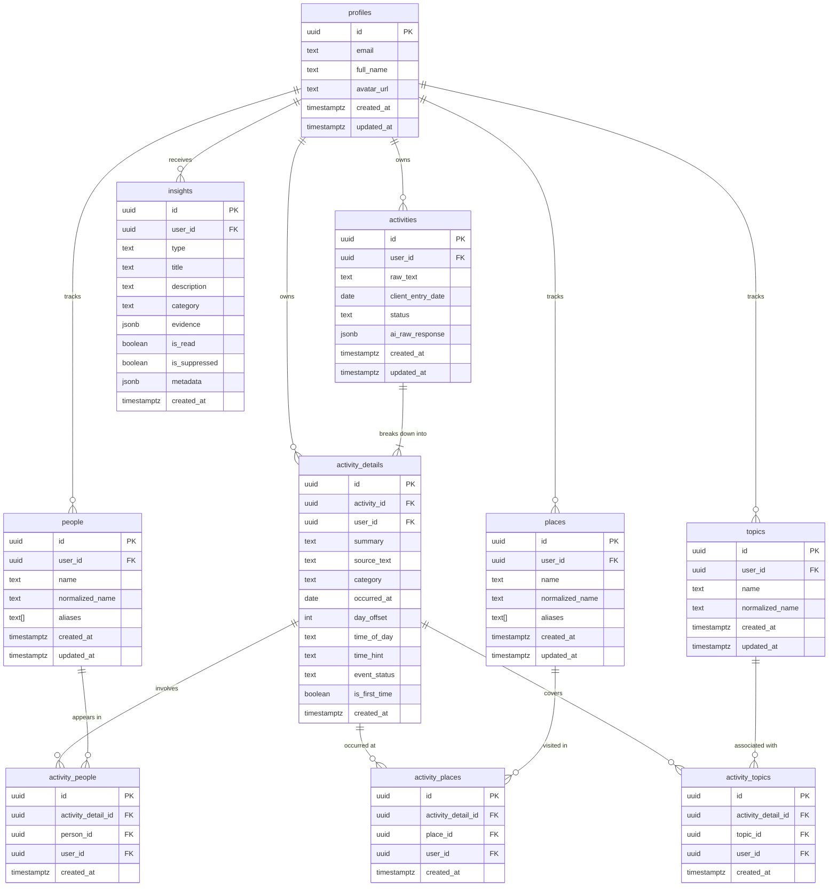

# Life Memory — Database Reference Manual

> **Document Version:** 1.3  
> **Status:** Sprint 0 Deliverable (Non-Code Specification)  
> **Complements:** [ARCHITECTURE.md](./ARCHITECTURE.md) (Complete Supabase PostgreSQL DDL, Views & RLS Policies)  
> **Covers:** ERD Diagram · Data Lifecycle · Supabase JS SDK Query Patterns · Dynamic Direct Demo Seeding (Persona Jimmy)

---

## Table of Contents

1. [Entity Relationship Diagram (ERD)](#1-entity-relationship-diagram-erd)
2. [Data Lifecycle & Reactive Views](#2-data-lifecycle--reactive-views)
3. [Supabase JS SDK Query Patterns (Hardened)](#3-supabase-js-sdk-query-patterns-hardened)
4. [Demo Seed Data — Persona Jimmy (Direct Dynamic Seeding)](#4-demo-seed-data--persona-jimmy-direct-dynamic-seeding)

---

## 1. Entity Relationship Diagram (ERD)



### Architectural Distinctions:
1. **`activity_details.occurred_at` (Authoritative Resolved Date):** Computed at extraction time (`client_entry_date + (day_offset || INTERVAL '1 day')`). This is the sole true date of each atomic event. All timeline grouping, month filtering, and entity boundaries query this column.
2. **`activities.client_entry_date` (Prompt Reference Anchor):** Represents the user's local calendar date when the note was submitted. This is passed directly to the Gemini API as `reference_date` so relative temporal expressions ("yesterday", "tadi siang") are resolved accurately.
3. **Atomic Granularity & 7 Categories:** Multi-activity logs cleanly produce multiple `activity_details` rows, each with its own single enum category (`career`, `social`, `health`, `learning`, `leisure`, `routine`, `other`) and individual `occurred_at`.
4. **Decoupled Identity, Aliases & Derived Stats:** Tables `people`, `places`, and `topics` store immutable identity (`id`, `user_id`, `name`, `normalized_name`, `aliases`). All interaction counts and boundary dates (`first_seen_at`, `last_seen_at`) are dynamically computed via PostgreSQL Views with `event_status = 'completed'` filtering.

---

## 2. Data Lifecycle & Reactive Views

### 2.1 Cascade Behaviour on Delete

```
User Deletes Account (profiles row deleted)
  ├── CASCADE: activities (all raw logs deleted)
  │     └── CASCADE: activity_details (all extracted items deleted)
  │           ├── CASCADE: activity_people (all link rows deleted)
  │           ├── CASCADE: activity_places (all link rows deleted)
  │           └── CASCADE: activity_topics (all link rows deleted)
  ├── CASCADE: people (all tracked people records deleted)
  ├── CASCADE: places (all tracked place records deleted)
  ├── CASCADE: topics (all tracked topic records deleted)
  └── CASCADE: insights (all generated insights deleted)
```

> **Data Isolation Guarantee:** Supabase RLS enforces `(SELECT auth.uid()) = user_id` across all 10 tables and security-invoker views.

### 2.2 PostgreSQL Reactive Stats Views

To avoid stale cache columns, desynchronized triggers, and timeline corruption during edits, deletes, or backdated logs, entity counters are defined as native PostgreSQL views:

```sql
-- 1. Reactive People Directory View
CREATE OR REPLACE VIEW public.v_people_with_stats
WITH (security_invoker = true) AS
SELECT
    p.id,
    p.user_id,
    p.name,
    p.normalized_name,
    p.aliases,
    COALESCE(COUNT(ad.id) FILTER (WHERE ad.event_status = 'completed'), 0)::INT AS interaction_count,
    MIN(ad.occurred_at) FILTER (WHERE ad.event_status = 'completed') AS first_seen_at,
    MAX(ad.occurred_at) FILTER (WHERE ad.event_status = 'completed') AS last_seen_at,
    p.created_at,
    p.updated_at
FROM public.people p
LEFT JOIN public.activity_people ap ON ap.person_id = p.id
LEFT JOIN public.activity_details ad ON ad.id = ap.activity_detail_id
GROUP BY p.id;

-- 2. Reactive Places Directory View
CREATE OR REPLACE VIEW public.v_places_with_stats
WITH (security_invoker = true) AS
SELECT
    pl.id,
    pl.user_id,
    pl.name,
    pl.normalized_name,
    pl.aliases,
    COALESCE(COUNT(ad.id) FILTER (WHERE ad.event_status = 'completed'), 0)::INT AS visit_count,
    MIN(ad.occurred_at) FILTER (WHERE ad.event_status = 'completed') AS first_visit_at,
    MAX(ad.occurred_at) FILTER (WHERE ad.event_status = 'completed') AS last_visit_at,
    pl.created_at,
    pl.updated_at
FROM public.places pl
LEFT JOIN public.activity_places apl ON apl.place_id = pl.id
LEFT JOIN public.activity_details ad ON ad.id = apl.activity_detail_id
GROUP BY pl.id;

-- 3. Reactive Topics Directory View
CREATE OR REPLACE VIEW public.v_topics_with_stats
WITH (security_invoker = true) AS
SELECT
    t.id,
    t.user_id,
    t.name,
    t.normalized_name,
    COALESCE(COUNT(ad.id) FILTER (WHERE ad.event_status = 'completed'), 0)::INT AS activity_count,
    MIN(ad.occurred_at) FILTER (WHERE ad.event_status = 'completed') AS first_seen_at,
    MAX(ad.occurred_at) FILTER (WHERE ad.event_status = 'completed') AS last_seen_at,
    t.created_at,
    t.updated_at
FROM public.topics t
LEFT JOIN public.activity_topics atp ON atp.topic_id = t.id
LEFT JOIN public.activity_details ad ON ad.id = atp.activity_detail_id
GROUP BY t.id;
```

---

## 3. Supabase JS SDK Query Patterns (Hardened)

### 3.1 Timeline Feed (Grouped by Atomic `occurred_at`)

```typescript
// lib/queries/timeline.ts
export async function getTimelineFeed(
  supabase: SupabaseClient,
  userId: string,
  categoryFilter?: ActivityCategory
) {
  let query = supabase
    .from('activity_details')
    .select(`
      id,
      activity_id,
      summary,
      source_text,
      category,
      occurred_at,
      day_offset,
      time_of_day,
      time_hint,
      event_status,
      is_first_time,
      activities!inner ( id, raw_text, status ),
      activity_people ( people ( id, name ) ),
      activity_places ( places ( id, name ) ),
      activity_topics ( topics ( id, name ) )
    `)
    .eq('user_id', userId)
    .order('occurred_at', { ascending: false });

  if (categoryFilter) {
    query = query.eq('category', categoryFilter);
  }

  const { data, error } = await query;
  if (error) throw error;
  return data;
}
```

---

### 3.2 People Directory & Detail

```typescript
// lib/queries/people.ts
export async function getPeopleDirectory(
  supabase: SupabaseClient,
  userId: string,
  sort: 'interaction_count' | 'last_seen_at' | 'first_seen_at' = 'interaction_count'
) {
  return supabase
    .from('v_people_with_stats')
    .select('*')
    .eq('user_id', userId)
    .order(sort, { ascending: sort === 'first_seen_at' });
}

export async function getPersonDetail(
  supabase: SupabaseClient,
  userId: string,
  personId: string
) {
  const { data: person, error: personError } = await supabase
    .from('v_people_with_stats')
    .select('*')
    .eq('user_id', userId)
    .eq('id', personId)
    .single();

  if (personError) throw personError;

  const { data: activities, error: actError } = await supabase
    .from('activity_people')
    .select(`
      activity_details!inner (
        id,
        summary,
        source_text,
        category,
        occurred_at,
        time_of_day,
        time_hint,
        event_status,
        is_first_time,
        activity_places ( places ( id, name ) ),
        activity_topics ( topics ( id, name ) )
      )
    `)
    .eq('user_id', userId)
    .eq('person_id', personId)
    .eq('activity_details.event_status', 'completed')
    .order('occurred_at', { ascending: false, foreignTable: 'activity_details' });

  if (actError) throw actError;

  return { person, activities: activities?.map((a) => a.activity_details) ?? [] };
}
```

---

### 3.3 Places & Topics Directories

```typescript
// lib/queries/places.ts
export async function getPlacesDirectory(
  supabase: SupabaseClient,
  userId: string,
  sort: 'visit_count' | 'last_visit_at' | 'first_visit_at' = 'visit_count'
) {
  return supabase
    .from('v_places_with_stats')
    .select('*')
    .eq('user_id', userId)
    .order(sort, { ascending: sort === 'first_visit_at' });
}

// lib/queries/topics.ts
export async function getTopicsDirectory(
  supabase: SupabaseClient,
  userId: string,
  sort: 'activity_count' | 'last_seen_at' | 'first_seen_at' = 'activity_count'
) {
  return supabase
    .from('v_topics_with_stats')
    .select('*')
    .eq('user_id', userId)
    .order(sort, { ascending: sort === 'first_seen_at' });
}
```

---

### 3.4 Monthly Statistics (Accurate Unique Entities & Status Filtering)

```typescript
// lib/queries/stats.ts
export async function getMonthlyStats(
  supabase: SupabaseClient,
  userId: string,
  year: number,
  month: number // 1-indexed
) {
  const startDate = `${year}-${String(month).padStart(2, '0')}-01`;
  const lastDay = new Date(year, month, 0).getDate();
  const endDate = `${year}-${String(month).padStart(2, '0')}-${String(lastDay).padStart(2, '0')}`;

  // 1. Total completed atomic activities in the calendar month
  const { count: totalActivities } = await supabase
    .from('activity_details')
    .select('id', { count: 'exact', head: true })
    .eq('user_id', userId)
    .eq('event_status', 'completed')
    .gte('occurred_at', startDate)
    .lte('occurred_at', endDate);

  // 2. Category distribution & first-times
  const { data: details } = await supabase
    .from('activity_details')
    .select('id, category, is_first_time')
    .eq('user_id', userId)
    .eq('event_status', 'completed')
    .gte('occurred_at', startDate)
    .lte('occurred_at', endDate);

  // 3. Unique people who actively appeared in completed logs this month
  const { data: peopleInMonth } = await supabase
    .from('activity_people')
    .select('person_id, activity_details!inner ( occurred_at, event_status )')
    .eq('user_id', userId)
    .eq('activity_details.event_status', 'completed')
    .gte('activity_details.occurred_at', startDate)
    .lte('activity_details.occurred_at', endDate);
  const uniquePeopleCount = new Set(peopleInMonth?.map((p) => p.person_id)).size;

  // 4. Unique places visited this month
  const { data: placesInMonth } = await supabase
    .from('activity_places')
    .select('place_id, activity_details!inner ( occurred_at, event_status )')
    .eq('user_id', userId)
    .eq('activity_details.event_status', 'completed')
    .gte('activity_details.occurred_at', startDate)
    .lte('activity_details.occurred_at', endDate);
  const uniquePlacesCount = new Set(placesInMonth?.map((p) => p.place_id)).size;

  // 5. Unique topics practiced this month
  const { data: topicsInMonth } = await supabase
    .from('activity_topics')
    .select('topic_id, activity_details!inner ( occurred_at, event_status )')
    .eq('user_id', userId)
    .eq('activity_details.event_status', 'completed')
    .gte('activity_details.occurred_at', startDate)
    .lte('activity_details.occurred_at', endDate);
  const uniqueTopicsCount = new Set(topicsInMonth?.map((t) => t.topic_id)).size;

  return {
    totalActivities: totalActivities ?? 0,
    details: details ?? [],
    uniquePeopleCount,
    uniquePlacesCount,
    uniqueTopicsCount,
    startDate,
    endDate,
  };
}
```

---

### 3.5 "You Probably Forgot This" — Candidate Query (Dormancy & PostgREST Guard)

```typescript
// lib/queries/forgotten.ts
export async function getForgottenMemoryCandidates(
  supabase: SupabaseClient,
  userId: string,
  asOf: Date = new Date()
) {
  const asOfStr = asOf.toISOString().split('T')[0];
  const cutoffDate = new Date(asOf);
  cutoffDate.setDate(cutoffDate.getDate() - 14);
  const cutoffStr = cutoffDate.toISOString().split('T')[0];

  // Exclude resurfaced within last 30 days
  const recentCutoff = new Date(asOf);
  recentCutoff.setDate(recentCutoff.getDate() - 30);

  const { data: recentlySurfaced } = await supabase
    .from('insights')
    .select('metadata')
    .eq('user_id', userId)
    .eq('type', 'forgotten')
    .gte('created_at', recentCutoff.toISOString());

  const excludedDetailIds = (recentlySurfaced ?? [])
    .map((i) => (i.metadata as Record<string, string>)?.source_activity_detail_id)
    .filter(Boolean);

  // 1. Fetch completed activity details >= 14 days old
  let query = supabase
    .from('activity_details')
    .select(`
      id,
      summary,
      source_text,
      category,
      occurred_at,
      time_of_day,
      is_first_time,
      event_status,
      activities!inner ( id, raw_text ),
      activity_people ( people ( id, name, normalized_name ) ),
      activity_places ( places ( id, name, normalized_name ) ),
      activity_topics ( topics ( id, name, normalized_name ) )
    `)
    .eq('user_id', userId)
    .eq('event_status', 'completed')
    .lte('occurred_at', cutoffStr);

  // Guard against PostgREST empty array syntax error: .not('in', '()')
  if (excludedDetailIds.length > 0) {
    query = query.not('id', 'in', `(${excludedDetailIds.join(',')})`);
  }

  const { data: rawCandidates, error } = await query;
  if (error) throw error;

  // 2. Client-side / In-memory True Dormancy Check (Anchor entity not seen in >= 21 days)
  // Fetch latest appearance date for all relevant entities
  const { data: allPeople } = await supabase.from('v_people_with_stats').select('id, last_seen_at').eq('user_id', userId);
  const { data: allPlaces } = await supabase.from('v_places_with_stats').select('id, last_visit_at').eq('user_id', userId);

  const peopleLastSeenMap = new Map(allPeople?.map((p) => [p.id, p.last_seen_at]));
  const placesLastSeenMap = new Map(allPlaces?.map((p) => [p.id, p.last_visit_at]));

  const eligibleCandidates = (rawCandidates ?? []).filter((cand) => {
    const hasPerson = cand.activity_people && cand.activity_people.length > 0;
    const hasPlace = cand.activity_places && cand.activity_places.length > 0;
    const isFirstTime = cand.is_first_time;

    // Disqualify routine chores lacking anchors
    if (!hasPerson && !hasPlace && !isFirstTime) return false;

    // Check entity dormancy: all anchor entities must not have appeared within last 21 days
    let maxEntityLastSeen = cand.occurred_at;
    cand.activity_people?.forEach((ap) => {
      const ls = peopleLastSeenMap.get(ap.people.id);
      if (ls && ls > maxEntityLastSeen) maxEntityLastSeen = ls;
    });
    cand.activity_places?.forEach((apl) => {
      const lv = placesLastSeenMap.get(apl.places.id);
      if (lv && lv > maxEntityLastSeen) maxEntityLastSeen = lv;
    });

    const dormancyDays = Math.floor(
      (new Date(asOfStr).getTime() - new Date(maxEntityLastSeen).getTime()) / (1000 * 60 * 60 * 24)
    );

    return dormancyDays >= 21;
  });

  return eligibleCandidates;
}
```

---

## 4. Demo Seed Data — Persona Jimmy (Direct Dynamic Seeding)

### Persona Overview

| Field | Detail |
|---|---|
| **Name** | Jimmy |
| **Age** | 22 |
| **City** | New York City |
| **Background** | CS Senior at NYU + freelance developer |
| **Horizon** | 40 Raw Activity Logs $\to$ **44 Atomic Activity Details** (spanning ~56 days dynamically) |
| **Direct Seeding Rule** | **Zero LLM API Calls.** Pre-computed ground truth inserted directly to Postgres via `scripts/seed-demo.ts`. |
| **Relative Date Formula** | $\text{occurred\_at} = \text{CURRENT\_DATE} - (\text{offset\_days} \times \text{INTERVAL '1 day'})$ |

---

### Hidden Patterns Engineered for Discovery

| Pattern Type | Detail | Entries |
|---|---|---|
| **Recurring — Person** | Ethan: study partner, housemate-level close. Appears 11x across the dataset | #4, 6, 8, 13, 15, 22, 24, 29, **#33**, 38, 40 |
| **Recurring — Person (arc)** | Lena: appears first on Day -19, built up over 6 distinct shared moments | #13, 16, 19, 26, **#35**, 40 |
| **Recurring — Place** | Blank Street Coffee: 6 visits across the period | #2, 10, 19, 26, 30, 37 |
| **Recurring — Activity** | Late-night coding sessions: 5 instances in `career` | #7, 14, 20, 25, 33 |
| **First-Time (Place)** | 4 places visited for the first time | Blank Street (#2), Mamoun's (#8), Brooklyn Flea (#16), Spoonbill (#23b) |
| **First-Time (Experience)** | 4 genuine first-time milestones | Wok to Walk (#12), Client presentation (#21), Invoice (#27), RLS (#36) |
| **Forgotten Moment (S-14)** | **Entry #3 (Library stranger)**: Anchored permanently at **`offset_days = 29`** (exactly 29 days ago on any evaluation date). Single occurrence, never mentioned again. | #3 |
| **Monthly Reflection** | Grounded narrative citing capstone, freelance milestone, and Lena | Entries 1–40 |

---

### Seed Ground Truth Matrix (Direct Insertion Dataset)

*Note: Entries #11, #17, #23, and #31 contain two distinct activities and are cleanly split into discrete atomic records (`a` and `b`), ensuring each `activity_detail` has a single valid enum category.*

| # | offset_days | raw_text | Atomic Details & Extracted Entities |
|---|---|---|---|
| 1 | 30 | "first day of the month. went to campus early to grab my schedule. ran into Professor Hayes outside CS building — reminded me capstone deadline is soon." | **ad_01:** summary: "Grab schedule and capstone check-in with Professor Hayes", category: `learning`, people: ["Professor Hayes"], places: ["NYU Campus"], status: `completed` |
| 2 | 30 | "stopped by Blank Street Coffee on way home. first time going there. got oat latte, read about Next.js for 2 hours." | **ad_02:** summary: "First visit to Blank Street Coffee, study Next.js", category: `learning`, places: ["Blank Street Coffee"], topics: ["next.js"], is_first_time: `true` |
| 3 | **29** | "library from 10am to around 3. grinding algorithm problems and random guy sat down next to me. talked 40 mins about grad school... he's applying to carnegie mellon for systems research. don't know his name but genuinely good conversation. rare." | **ad_03:** summary: "Long conversation with grad applicant stranger at library", category: `learning`, places: ["Library"], status: `completed`, **[S-14 Anchor: 29 days ago]** |
| 4 | 28 | "kickoff meeting with Ethan and Priya for senior project. meal planning app for capstone. i'm doing backend API and database. Ethan's handling frontend. Priya is doing ML." | **ad_04:** summary: "Senior project kickoff with Ethan and Priya", category: `career`, people: ["Ethan", "Priya"], topics: ["api", "database"] |
| 5 | 27 | "freelance client reached out through linkedin. need full landing page redesign for their SaaS tool. said yes. reviewed their site tonight." | **ad_05:** summary: "Accepted freelance landing page redesign contract", category: `career`, topics: ["saas", "landing page"] |
| 6 | 26 | "morning basketball with Ethan at NYU court. haven't played since august, jump shot gone. grabbed breakfast at diner on Mercer." | **ad_06:** summary: "Morning basketball with Ethan and diner breakfast", category: `health`, people: ["Ethan"], places: ["NYU Court", "diner on Mercer"] |
| 7 | 25 | "stayed up until 2am designing database schema for senior project. relational model for meal recommendations took longer than expected." | **ad_07:** summary: "Late night schema design for senior project", category: `career`, topics: ["database schema"] |
| 8 | 24 | "lunch at Mamoun's Falafel with Ethan near campus. first time i've actually been inside. great food, stayed 2 hours." | **ad_08:** summary: "First lunch at Mamoun's Falafel with Ethan", category: `social`, people: ["Ethan"], places: ["Mamoun's Falafel"], is_first_time: `true` |
| 9 | 23 | "NYU career fair in afternoon. chatted with recruiters from mid-size companies. felt detached — hard to care about full-time when doing freelance." | **ad_09:** summary: "Attended NYU career fair and met recruiters", category: `career`, places: ["NYU Campus"] |
| 10 | 22 | "started build for freelance client's landing page. chose Next.js and Tailwind. worked from Blank Street Coffee for afternoon." | **ad_10:** summary: "Freelance dev session at Blank Street Coffee", category: `career`, places: ["Blank Street Coffee"], topics: ["next.js", "tailwind"] |
| 11a | 21 | "gym in morning for an hour. rest of day deep in academic papers on collaborative filtering algorithms for capstone." | **ad_11a:** summary: "Morning workout session", category: `health` |
| 11b | 21 | *(same log)* | **ad_11b:** summary: "Studied collaborative filtering algorithms for capstone", category: `learning`, topics: ["algorithms"] |
| 12 | 20 | "finished auth flow for client site and pushed hero section to staging. ordered takeout from Wok to Walk for first time. good food." | **ad_12:** summary: "Shipped auth flow and first takeout from Wok to Walk", category: `career`, places: ["Wok to Walk"], topics: ["auth"], is_first_time: `true` |
| 13 | 19 | "Ethan introduced me to his friend Lena today. went to Washington Square Park in afternoon. sat on grass and talked for hours. Lena's doing design internship." | **ad_13:** summary: "Met Lena with Ethan at Washington Square Park", category: `social`, people: ["Ethan", "Lena"], places: ["Washington Square Park"] |
| 14 | 18 | "another late night. building CMS integration for client page. coffee at 11pm was terrible idea, still awake at 1:30am debugging." | **ad_14:** summary: "Late night CMS integration debugging", category: `career`, topics: ["cms"] |
| 15 | 17 | "capstone check-in with Ethan and Priya over video call. demoed what we have so far to Professor Hayes. good feedback." | **ad_15:** summary: "Capstone demo check-in with team and Professor Hayes", category: `career`, people: ["Ethan", "Priya", "Professor Hayes"] |
| 16 | 16 | "went to Brooklyn Flea Market with Lena in morning. first time i've been there. found cool vintage denim jacket. walked around 3 hours." | **ad_16:** summary: "First trip to Brooklyn Flea Market with Lena", category: `leisure`, people: ["Lena"], places: ["Brooklyn Flea Market"], is_first_time: `true` |
| 17a | 15 | "quiet day at home. finished reading distributed systems chapter. went for run along Hudson in evening." | **ad_17a:** summary: "Finished distributed systems book chapter", category: `learning`, topics: ["distributed systems"] |
| 17b | 15 | *(same log)* | **ad_17b:** summary: "Evening run along Hudson River", category: `health`, places: ["Hudson River"] |
| 18 | 14 | "finished first version of landing page and sent to client for review. came together better than expected. took a walk after." | **ad_18:** summary: "Delivered first landing page version to client", category: `career`, topics: ["landing page"] |
| 19 | 13 | "went to Blank Street Coffee with Lena. she's stressed with job search — got rejected from place she really wanted. talked for couple hours." | **ad_19:** summary: "Coffee and catch-up with Lena at Blank Street", category: `social`, people: ["Lena"], places: ["Blank Street Coffee"] |
| 20 | 12 | "late night debugging session on capstone backend. found nasty N+1 query problem in meal lookup. fixed it. bed at 2:30am." | **ad_20:** summary: "Resolved N+1 backend query bug on capstone", category: `career`, topics: ["backend"] |
| 21 | 11 | "first video call with freelance client. walked them through landing page mockup over Zoom. first time doing client presentation for paying project." | **ad_21:** summary: "First paid client presentation via Zoom", category: `career`, topics: ["client presentation"], is_first_time: `true` |
| 22 | 10 | "implementing client's revisions. changed primary color to something warmer. Ethan came over and helped sanity-check mobile layout." | **ad_22:** summary: "Mobile layout review with Ethan", category: `career`, people: ["Ethan"], topics: ["design"] |
| 23a | 9 | "gym in the morning. took myself on long solo walk through Williamsburg in afternoon. wandered into Spoonbill bookstore. first time there. bought systems thinking book." | **ad_23a:** summary: "Morning gym workout", category: `health` |
| 23b | 9 | *(same log)* | **ad_23b:** summary: "First visit to Spoonbill & Sugartown bookstore", category: `leisure`, places: ["Williamsburg", "Spoonbill & Sugartown"], topics: ["systems thinking"], is_first_time: `true` |
| 24 | 8 | "capstone work session at library with Ethan and Priya. hammered out recommendation engine logic together. coming together well." | **ad_24:** summary: "Recommendation engine work session at library", category: `career`, people: ["Ethan", "Priya"], places: ["Library"], topics: ["recommendation engine"] |
| 25 | 7 | "late night client work — deployment issue with Vercel config. env vars weren't passing properly. shipped second revision at midnight." | **ad_25:** summary: "Fixed Vercel production deployment issue", category: `career`, topics: ["vercel"] |
| 26 | 6 | "met Lena at Blank Street Coffee. she got interview at startup in brooklyn next week. prepped potential questions for an hour." | **ad_26:** summary: "Interview prep session with Lena at Blank Street", category: `social`, people: ["Lena"], places: ["Blank Street Coffee"], topics: ["interview prep"] |
| 27 | 5 | "client approved final version of landing page. sent invoice right after. first time invoicing someone for development work. good feeling." | **ad_27:** summary: "First professional developer invoice sent", category: `career`, topics: ["invoice"], is_first_time: `true` |
| 28 | 4 | "slow morning at Union Square farmer's market. bought apples, honey, croissant. bumped into classmate Marcus. quick catch-up." | **ad_28:** summary: "Morning market walk and catch-up with Marcus", category: `routine`, people: ["Marcus"], places: ["Union Square Farmer's Market"] |
| 29 | 3 | "capstone crunch day. spent day coding and writing technical documentation. Ethan came over to co-work. ordered pizza, worked till midnight." | **ad_29:** summary: "Capstone documentation sprint with Ethan", category: `career`, people: ["Ethan"], topics: ["documentation"] |
| 30 | 2 | "morning lecture on system design. went to Blank Street Coffee after to explore Rust just out of curiosity. wanted to try something new." | **ad_30:** summary: "Explored Rust programming at Blank Street Coffee", category: `learning`, places: ["Blank Street Coffee"], topics: ["rust", "system design"] |
| 31a | 1 | "quick 30-min gym before campus. spent most of day on capstone integration tests. everything connecting. sent progress update to Professor Hayes." | **ad_31a:** summary: "Quick gym session before campus", category: `health` |
| 31b | 1 | *(same log)* | **ad_31b:** summary: "Shipped capstone integration test suite", category: `career`, people: ["Professor Hayes"], topics: ["integration tests"] |
| 32 | 0 | "halloween. didn't really do anything for it. feeling reflective." | **ad_32:** summary: "Quiet reflective evening at home", category: `routine` |
| 33 | 0 | "late night working on some polish for the capstone. Ethan came by, we ended up just watching something on Netflix after finishing the work." | **ad_33:** summary: "Late night capstone polish and Netflix with Ethan", category: `career`, people: ["Ethan"], topics: ["capstone"] |
| 34 | 13 | "ran into Priya at coffee cart near library. caught up for 20 mins — talked about her ML model progress." | **ad_34:** summary: "Coffee chat with Priya near library", category: `social`, people: ["Priya"], places: ["Library area"], topics: ["machine learning"] |
| 35 | 5 | "stopped by the grocery store with Lena after work to pick up dinner ingredients. we talked about how different october feels compared to september — more freelance, less school. she's prepping for another interview next week." | **ad_35:** summary: "Grocery shopping and reflection with Lena", category: `social`, people: ["Lena"], places: ["Grocery store"] |
| 36 | 17 | "read about Supabase Row Level Security while waiting for class to start. went deep on it for 2 hours. first time understanding DB security policies properly." | **ad_36:** summary: "First deep understanding of Row Level Security", category: `learning`, topics: ["supabase", "rls"], is_first_time: `true` |
| 37 | 2 | "went to Blank Street Coffee alone in morning before Ethan came over. worked on freelance project notes. thinking about raising rate." | **ad_37:** summary: "Morning freelance project notes at Blank Street", category: `career`, places: ["Blank Street Coffee"], topics: ["freelance"] |
| 38 | 10 | "texted Ethan about client revisions. he came over for a bit. talked more about post-graduation job market anxiety than work." | **ad_38:** summary: "Post-grad career anxiety discussion with Ethan", category: `social`, people: ["Ethan"] |
| 39 | 20 | "system design lecture in morning. professor explained consistent hashing — finally clicked after months. grabbed food at campus hall after." | **ad_39:** summary: "Mastered consistent hashing in system design lecture", category: `learning`, places: ["NYU Campus"], topics: ["consistent hashing"] |
| 40 | 0 | "dinner with Ethan and Lena at Thai place on Bedford Ave tonight. talked for 3 hours about the month, job search, and graduation. feel less behind than i thought." | **ad_40:** summary: "Wrap-up dinner with Ethan and Lena on Bedford Ave", category: `social`, people: ["Ethan", "Lena"], places: ["Thai restaurant on Bedford Ave"] |
